# Wholesale Customer Segmentation Using K-Means

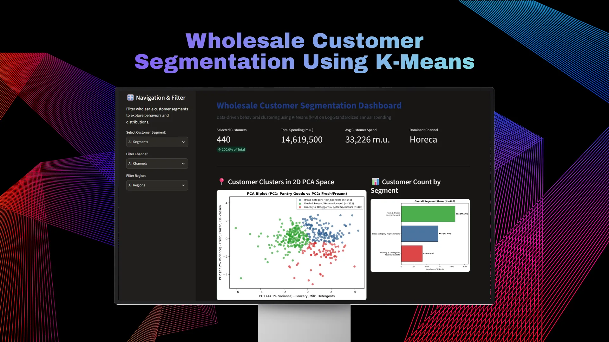


## Project Overview

Wholesale Customer Segmentation Using K-Means is an end-to-end unsupervised machine learning project that segments 440 clients of a wholesale distributor based on their annual spending across six product categories: `Fresh`, `Milk`, `Grocery`, `Frozen`, `Detergents_Paper`, and `Delicassen`. By combining `log1p` skewness normalization, `StandardScaler` feature standardization, multi-algorithm benchmarking, and 2D Principal Component Analysis (PCA) projection, the pipeline uncovers three distinct behavioral customer segments and surfaces them through an interactive Streamlit analytics dashboard.

## Problem Statement & Objectives

Wholesale distributors serve diverse commercial buyers ranging from hotels, restaurants, and cafes (`Horeca`) to independent grocery stores and supermarkets (`Retail`). Treating all accounts with a uniform sales, pricing, and logistics model leads to misaligned promotions, suboptimal cold-chain routing, and elevated churn risk among high-volume accounts. Because the raw dataset contains no pre-assigned behavioral segment labels and exhibits extreme right-skewness, standard distance-based clustering on raw spending isolates a handful of mega-spenders instead of revealing actionable groups.

- **Behavioral Segmentation:** Discover natural customer groups strictly from annual spending patterns across six product categories without leaking `Channel` or `Region` labels into model training.
- **Skewness & Outlier Mitigation:** Prevent high-volume wholesale buyers from distorting Euclidean centroids by evaluating log-transformation and scaling pipelines across multiple cluster counts (`k = 2..10`).
- **Algorithm & Cluster Selection:** Benchmark K-Means against Agglomerative Hierarchical Clustering (Ward linkage) and Gaussian Mixture Models (GMM) using Inertia, Silhouette Score, Davies-Bouldin Index, and Calinski-Harabasz Index.
- **Post-Hoc Profiling & Decision Support:** Profile the selected segments on original monetary units (`m.u.`), cross-tabulate them against operational channel and region, and deliver an interactive Streamlit dashboard for segment exploration.

## Data & Input Sources

The project uses the Wholesale Customers dataset from the UCI Machine Learning Repository (UCI ID: 292, DOI: `10.24432/C5030X`), stored locally at `dataset/original/Wholesale_Customers.csv` alongside its descriptor `dataset/original/metadata.json` and root `metadata.json`. Data quality auditing in `src/clustering.py` confirms 440 observations across 8 integer columns with zero missing values, zero duplicate rows, zero negative entries, and strictly positive spending values (minimum `3 m.u.`). Although `metadata.json` lists `num_features: 7` and `target_col: ["Region"]`, both `Channel` and `Region` are excluded from the clustering feature matrix and used solely for post-clustering descriptive profiling.

| Attribute | Value |
|---|---|
| Dataset / Input Source | Wholesale Customers Dataset (UCI ID: 292) |
| Source | `dataset/original/Wholesale_Customers.csv` (UCI Machine Learning Repository) |
| Format | Tabular CSV (`Integer` columns) |
| Samples / Records | 440 wholesale client records |
| Features / Input Shape | `440 x 6` numerical spending matrix (`Fresh`, `Milk`, `Grocery`, `Frozen`, `Detergents_Paper`, `Delicassen`) |
| Profiling Attributes | `Channel` (`1 = Horeca`, `2 = Retail`), `Region` (`1 = Lisbon`, `2 = Oporto`, `3 = Other Region`) |
| Target / Label | None (unsupervised behavioral clustering) |

## Data Preprocessing & Feature Engineering

Annual wholesale spending exhibits severe positive skewness (`+2.56` on `Fresh` up to `+11.15` on `Delicassen`) and heavy right tails, with IQR outlier rates between `4.55%` and `9.77%` across categories. Because extreme spending reflects genuine institutional bulk buyers rather than data errors, outliers are retained and stabilized mathematically before clustering. Three preprocessing pipelines are benchmarked in `src/clustering.py`, with `Log1p + StandardScaler` selected as the primary pipeline and paired with a 2-component PCA projection for cluster visualization.

| Transformation | Input | Output | Purpose |
|---|---|---|---|
| Feature Isolation | 8-column raw table | `440 x 6` spending matrix | Exclude `Channel` and `Region` to keep segmentation purely spend-driven |
| `np.log1p` Transform | Raw `m.u.` spending | Compressed log-scale values | Reduce skewness from `[+2.56, +11.15]` to `[-1.58, -0.22]` without dropping high-value clients |
| `StandardScaler` | Log-transformed features | Zero-mean, unit-variance features | Ensure equal Euclidean distance weighting across high- and low-nominal categories |
| `RobustScaler` (Sensitivity) | Log-transformed features | Median/IQR-scaled features | Benchmark scale sensitivity against `StandardScaler` across `k = 2..10` |
| `PCA(n_components=2)` | Standardized log features | `PC1` (44.08%), `PC2` (27.19%) | Project 6D clusters onto a 2D biplot capturing `71.27%` total variance |

1. Load `Wholesale_Customers.csv` and verify zero nulls, duplicates, negative values, or zero-spend entries across all six product categories.
2. Isolate the six numerical spending columns (`Fresh`, `Milk`, `Grocery`, `Frozen`, `Detergents_Paper`, `Delicassen`) into the feature matrix `X`.
3. Apply `np.log1p(X)` to compress extreme monetary tails safely since every category minimum is at least `3 m.u.`.
4. Fit and apply `StandardScaler` to obtain standardized Z-score inputs (`X_scaled`) for distance-based clustering.
5. Fit `PCA(n_components=2, random_state=42)` on `X_scaled` to compute `PC1` and `PC2` coordinates for downstream visualization and dashboard filtering.

## Tech Stack

| Category | Technology | Purpose |
|---|---|---|
| Programming Language | Python | Core analytical pipeline, modeling script, and dashboard runtime |
| Machine Learning | Scikit-Learn | `KMeans`, `AgglomerativeClustering`, `GaussianMixture`, `PCA`, `StandardScaler`, `RobustScaler`, clustering metrics |
| Data Manipulation | Pandas | CSV ingestion, data auditing, cross-tabulation, and cluster profile aggregation |
| Numerical Computing | NumPy | Vectorized `log1p` transformations and cluster size counting |
| Scientific Computing | SciPy | Statistical computations supporting distribution and modeling workflows |
| Visualization | Matplotlib | Multi-panel diagnostic figures, PCA biplots, elbow curves, and bar charts |
| Statistical Plotting | Seaborn | Histograms with KDE, boxplots, correlation matrices, and Z-score heatmaps |
| Interactive Dashboard | Streamlit | Web dashboard (`streamlit/app.py`) for interactive segment, channel, and region filtering |
| Interactive Notebook | Jupyter Notebook | Step-by-step exploratory analysis and modeling (`notebooks/customer_segmentation.ipynb`) |

## Machine Learning Approach

This project applies an unsupervised learning formulation to partition unlabeled wholesale customer spending data into cohesive, interpretable buyer personas. By modeling directly on log-standardized expenditure rather than pre-existing administrative labels, the approach avoids channel leakage and captures cross-channel purchasing structures, such as high-spending Horeca accounts that share multi-category volume traits with large retailers.

| Attribute | Value |
|---|---|
| Learning Paradigm | Unsupervised Learning |
| Problem Domain | Wholesale B2B Customer Analytics |
| ML Task | Clustering & Dimensionality Reduction |
| Input Features | 6 continuous annual spending variables (`Fresh`, `Milk`, `Grocery`, `Frozen`, `Detergents_Paper`, `Delicassen`) |
| Output | 3 discrete behavioral cluster assignments (`Cluster 0`, `Cluster 1`, `Cluster 2`) + 2D PCA coordinates |
| Clustering Strategy | Centroid-based partitioning (K-Means) benchmarked against Ward hierarchical clustering and GMM |

## Model Overview

The primary model is Scikit-Learn `KMeans` with `k = 3` clusters, initialized via `k-means++` (`n_init = 25`, `random_state = 42`) on `Log1p + StandardScaler` transformed features. Alongside K-Means, `AgglomerativeClustering` (Ward linkage) and `GaussianMixture` (full covariance) are evaluated across `k = 2..10` to validate partition stability, while `PCA(n_components=2)` provides low-dimensional interpretability.

| Model / Component | Algorithm / Family | Role | Input Space | Output |
|---|---|---|---|---|
| `KMeans(n_clusters=3)` | Centroid-Based Partitioning (`k-means++`) | Primary final segmentation model | `440 x 6` `Log1p + StandardScaler` | Hard cluster labels (`0, 1, 2`) & centroids |
| `AgglomerativeClustering` | Hierarchical Bottom-Up (`ward` linkage) | Structural benchmark across `k = 2..10` | `440 x 6` raw & log-scaled matrices | Hierarchical cluster assignments |
| `GaussianMixture` | Probabilistic Soft Clustering (`full` covariance) | Density-based benchmark across `k = 2..10` | `440 x 6` raw & log-scaled matrices | Component cluster assignments |
| `PCA(n_components=2)` | Orthogonal Linear Projection | 2D visualization & feature loading analysis | `440 x 6` `Log1p + StandardScaler` | `PC1` (44.08%) & `PC2` (27.19%) coordinates |

## ML Workflow

1. **Data Ingestion & Quality Audit:** Load [Wholesale_Customers.csv](dataset/original/Wholesale_Customers.csv) and verify schema, missingness, duplicates, value bounds, and discrepancies against [metadata.json](metadata.json) inside `audit_data()` in [src/clustering.py](src/clustering.py).
2. **Exploratory Data Analysis:** Inspect raw skewness, IQR outliers, log-transformed distributions, and Pearson correlations across raw and log scales, documented in [notebooks/customer_segmentation.ipynb](notebooks/customer_segmentation.ipynb) and [final_report.md](final_report.md).
3. **Multi-Pipeline & Multi-Model Experimentation:** Execute `run_model_comparison()` across three preprocessing pipelines (`Raw + StandardScaler`, `Log1p + StandardScaler`, `Log1p + RobustScaler`), three algorithms (`K-Means`, `Agglomerative (Ward)`, `Gaussian Mixture`), and cluster counts `k = 2..10`, exporting 81 evaluation rows to [dataset/model_comparison.csv](dataset/model_comparison.csv).
4. **Final Model Fitting & PCA Projection:** Fit `KMeans(n_clusters=3, random_state=42, n_init=25)` and `PCA(n_components=2, random_state=42)` on `Log1p + StandardScaler` data in `fit_final_model()`, saving client assignments to [dataset/clustered_customers.csv](dataset/clustered_customers.csv).
5. **Post-Hoc Segment Profiling:** Aggregate raw-scale mean, median, standard deviation, and total revenue per segment alongside `Channel` and `Region` cross-tabulations via `compute_cluster_profiles()`, exporting [dataset/cluster_profiles.csv](dataset/cluster_profiles.csv).
6. **Diagnostic Visualization & Dashboard Delivery:** Generate 11 analytical charts in `figures/` via `generate_visualizations()` and serve interactive segment exploration through [streamlit/app.py](streamlit/app.py).

## ML Pipeline Architecture

The architecture diagram below maps the verified data flow in `src/clustering.py` and `streamlit/app.py`, from raw CSV ingestion and dual-track experimentation through final `k = 3` K-Means fitting, PCA projection, CSV/figure artifact export, and interactive Streamlit filtering.

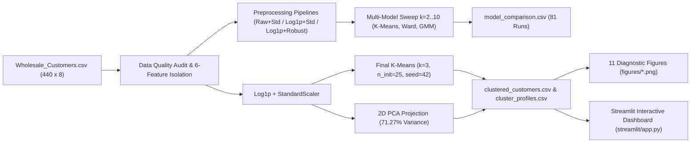

## Model Training & Configuration

Because clustering is unsupervised, `fit_final_model()` fits `KMeans` directly on the full `440 x 6` `Log1p + StandardScaler` feature matrix without a train/test split, minimizing Within-Cluster Sum of Squares (Inertia) via Lloyd's algorithm with `k-means++` centroid initialization. All random seeds are fixed at `42` for reproducibility.

| Parameter / Setting | Configured Value | Scope | Effect |
|---|---|---|---|
| `n_clusters` | `3` | Final K-Means | Partitions clients into 3 balanced behavioral segments |
| `init` | `k-means++` (Scikit-Learn default) | K-Means | Spreads initial centroids to improve convergence stability |
| `n_init` | `25` | K-Means | Runs 25 centroid initializations and keeps the lowest-inertia solution |
| `random_state` | `42` | K-Means, GMM, PCA | Fixes centroid initialization and SVD/EM stochasticity |
| `linkage` | `ward` | Agglomerative Clustering | Minimizes within-cluster variance during bottom-up merging |
| `n_init` | `10` | Gaussian Mixture | Runs 10 EM initializations for GMM benchmark stability |
| `n_components` | `2` | PCA | Extracts top 2 orthogonal principal components (`71.27%` variance) |

```python
X_log = np.log1p(df[FEATURE_COLS])
scaler = StandardScaler()
X_scaled = scaler.fit_transform(X_log)

km = KMeans(n_clusters=3, random_state=42, n_init=25)
labels = km.fit_predict(X_scaled)

pca = PCA(n_components=2, random_state=42)
pca_coords = pca.fit_transform(X_scaled)
```

## Hyperparameter Tuning & Experiment Tracking

Hyperparameter search in `run_model_comparison()` systematically sweeps cluster cardinality `k` from `2` to `10` across three preprocessing pipelines (`Raw + StandardScaler`, `Log1p + StandardScaler`, `Log1p + RobustScaler`) and three algorithms, recording all 81 configurations in `dataset/model_comparison.csv`. Tracking cluster sizes alongside internal metrics exposed a "Raw Data Trap": unlogged data inflated Silhouette Scores (`0.7925` for Agglomerative `k=2`; `0.5483` for K-Means `k=3`) solely by isolating 2 to 6 extreme spenders into singleton/micro clusters (`[434, 6]` and `[45, 393, 2]`).

| Preprocessing Pipeline | Selected Algorithm | `k` | Silhouette Score | Davies-Bouldin Index | Calinski-Harabasz Index | Cluster Sizes | Observation |
|---|---|---|---|---|---|---|---|
| `Raw + StandardScaler` | K-Means | `3` | `0.5483` | `0.9279` | `140.14` | `[45, 393, 2]` | Degenerate micro-cluster isolating 2 outliers |
| `Raw + StandardScaler` | Agglomerative (Ward) | `2` | `0.7925` | `0.9086` | `105.44` | `[434, 6]` | Inflated Silhouette driven by 6-client outlier split |
| `Log1p + RobustScaler` | K-Means | `3` | `0.2447` | `1.3200` | `138.18` | `[151, 209, 80]` | Consistent structure, slightly lower Silhouette/CHI than StandardScaler |
| `Log1p + StandardScaler` | K-Means | `3` | `0.2583` | `1.3482` | `152.84` | `[145, 212, 83]` | Balanced, interpretable 3-segment partition (Selected) |

## Model Comparison & Selection

On the primary `Log1p + StandardScaler` pipeline, K-Means consistently outperformed both Agglomerative Clustering (Ward) and Gaussian Mixture Models in Calinski-Harabasz Index and Silhouette Score at `k = 2` and `k = 3`. Although `k = 2` scored slightly higher on Silhouette (`0.2903` vs `0.2583`), `k = 2` merely splits buyers into Horeca-leaning vs. Retail-leaning groups (`[252, 188]`). Selecting `K-Means (k = 3)` achieves a lower (better) Davies-Bouldin Index (`1.3482` vs `1.3515`), maintains healthy cluster proportions (`32.95%`, `48.18%`, `18.86%`), and separates high-spending multi-category Key Accounts (`Cluster 0`) from shelf-stable retail specialists (`Cluster 2`).

| Algorithm (`Log1p + StandardScaler`) | `k` | Inertia (WCSS) | Silhouette Score | Davies-Bouldin Index | Calinski-Harabasz Index | Cluster Sizes |
|---|---|---|---|---|---|---|
| K-Means | `2` | `1844.06` | `0.2903` | `1.3515` | `189.05` | `[252, 188]` |
| **K-Means (Selected)** | **`3`** | **`1553.41`** | **`0.2583`** | **`1.3482`** | **`152.84`** | **`[145, 212, 83]`** |
| K-Means | `4` | `1386.86` | `0.1885` | `1.5408` | `131.32` | `[61, 129, 132, 118]` |
| Agglomerative (Ward) | `2` | — | `0.2585` | `1.6004` | `134.62` | `[178, 262]` |
| Agglomerative (Ward) | `3` | — | `0.2547` | `1.5390` | `116.80` | `[262, 53, 125]` |
| Gaussian Mixture | `2` | — | `0.2656` | `1.3908` | `165.42` | `[166, 274]` |
| Gaussian Mixture | `3` | — | `0.2393` | `2.4967` | `92.53` | `[66, 224, 150]` |

## Model Artifacts & Checkpoints

Rather than exporting serialized binary model checkpoints (`.pkl` or `.joblib`), `src/clustering.py` persists the deterministic analytical outputs as structured CSV tables and high-resolution (`150 DPI`) PNG figures. Running `src/clustering.py` re-fits the K-Means and PCA models on `Wholesale_Customers.csv` in seconds and populates these deliverables.

| Artifact | Format | Purpose | Location |
|---|---|---|---|
| `clustered_customers.csv` | CSV | 440 client records enriched with `Cluster`, `Cluster_Name`, `PC1`, `PC2`, `Channel_Desc`, and `Region_Desc` | `dataset/clustered_customers.csv` |
| `cluster_profiles.csv` | CSV | Per-cluster counts, percentages, Channel/Region breakdown, and raw-scale Mean/Median/Std/Total spend | `dataset/cluster_profiles.csv` |
| `model_comparison.csv` | CSV | Full 81-row evaluation table across 3 preprocessing pipelines, 3 algorithms, and `k = 2..10` | `dataset/model_comparison.csv` |
| Analytical Plot Suite | PNG (11 files) | EDA, Elbow/Silhouette curves, model comparison, PCA biplot, heatmaps, and raw-scale profiles | `figures/` |

## Model Evaluation & Results

Internal clustering validation on the full `440 x 6` `Log1p + StandardScaler` dataset confirms that `K-Means (k = 3)` achieves coherent geometric separation (`Silhouette = 0.2583`, `Davies-Bouldin = 1.3482`, `Calinski-Harabasz = 152.84`, `WCSS Inertia = 1553.41`) while a 2D PCA projection retains `71.27%` of total variance (`44.08%` on `PC1` driven by `Grocery`, `Detergents_Paper`, and `Milk`; `27.19%` on `PC2` driven by `Fresh`, `Frozen`, and `Delicassen`). Because this is an unsupervised clustering task on a single 440-client cross-sectional dataset without ground-truth cluster labels, metrics reflect internal geometric cohesion rather than supervised test-set accuracy, and moderate boundary overlap around `0.2583` Silhouette is expected in continuous spending data.

| Segment | Clients (`n` / `%`) | Mean Total Spend (`m.u.`) | Median Total Spend (`m.u.`) | Total Revenue (`m.u.` / `%`) | Dominant Channel |
|---|---|---|---|---|---|
| **Cluster 0: Broad-Category High Spenders** | `145` (`32.95%`) | `53,273.41` | `46,100.00` | `7,724,645` (`52.84%`) | `61.38%` Retail (`38.62%` Horeca) |
| **Cluster 1: Fresh & Frozen / Horeca Focused** | `212` (`48.18%`) | `21,081.19` | `18,498.00` | `4,469,212` (`30.57%`) | `98.58%` Horeca (`1.42%` Retail) |
| **Cluster 2: Grocery & Detergents / Retail Specialists** | `83` (`18.86%`) | `29,224.61` | `27,251.00` | `2,425,643` (`16.59%`) | `60.24%` Retail (`39.76%` Horeca) |

- **Cluster 0 — Broad-Category High Spenders (Key Accounts):** Accounts for `32.95%` of clients yet generates `52.84%` (`7.72M m.u.`) of total wholesale revenue, exhibiting positive Z-scores across every product category (`+0.31` to `+0.81` in standardized log space) and the highest raw mean spending in `Fresh` (`17,182.39 m.u.`), `Grocery` (`13,380.98 m.u.`), `Milk` (`10,658.08 m.u.`), `Frozen` (`4,181.11 m.u.`), and `Delicassen` (`2,867.22 m.u.`).
- **Cluster 1 — Fresh & Frozen / Horeca Focused:** Represents the largest customer group (`48.18%` of clients) and is `98.58%` Horeca (`209` of `212` clients), concentrating spend on perishables (`Fresh` mean `11,992.59 m.u.`, `Frozen` mean `3,277.84 m.u.`) while spending minimally on `Detergents_Paper` (`425.91 m.u.` mean, `-0.75` Z-score).
- **Cluster 2 — Grocery & Detergents / Retail Specialists:** Comprises `18.86%` of clients (`60.24%` Retail) with strong shelf-stable pantry and sanitation demand (`Grocery` mean `12,397.28 m.u.`, `Detergents_Paper` mean `5,446.23 m.u.`, `Milk` mean `7,010.90 m.u.`) and sharply negative deviations on `Fresh` (`-1.16` Z-score) and `Frozen` (`-1.12` Z-score).

## Results Visualization & Preview

### 1. Streamlit Dashboard Overview — KPI Summary & PCA Cluster Space
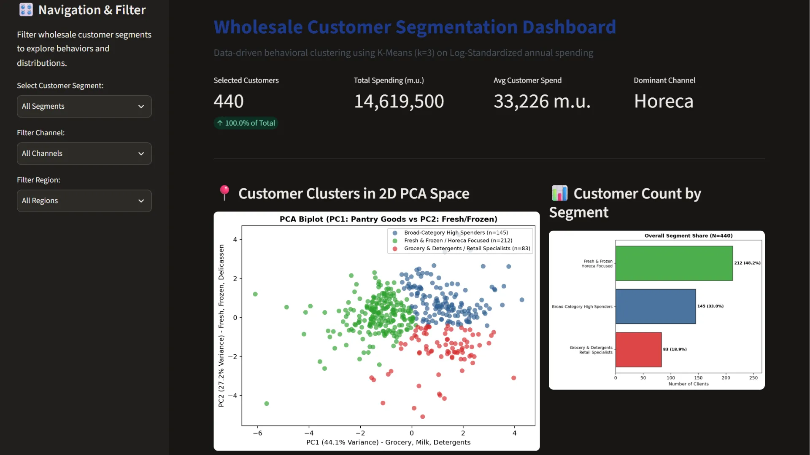
The top section of the interactive Streamlit dashboard displays global sidebar filters (`All Segments`, `All Channels`, `All Regions`), four real-time KPI cards summarizing the 440 clients (`14,619,500 m.u.` total spend, `33,226 m.u.` average spend, `Horeca` dominant channel), the 2D PCA cluster scatter plot, and the horizontal segment share bar chart.

### 2. Streamlit Dashboard — Category Spending Profiles & Channel/Region Breakdown
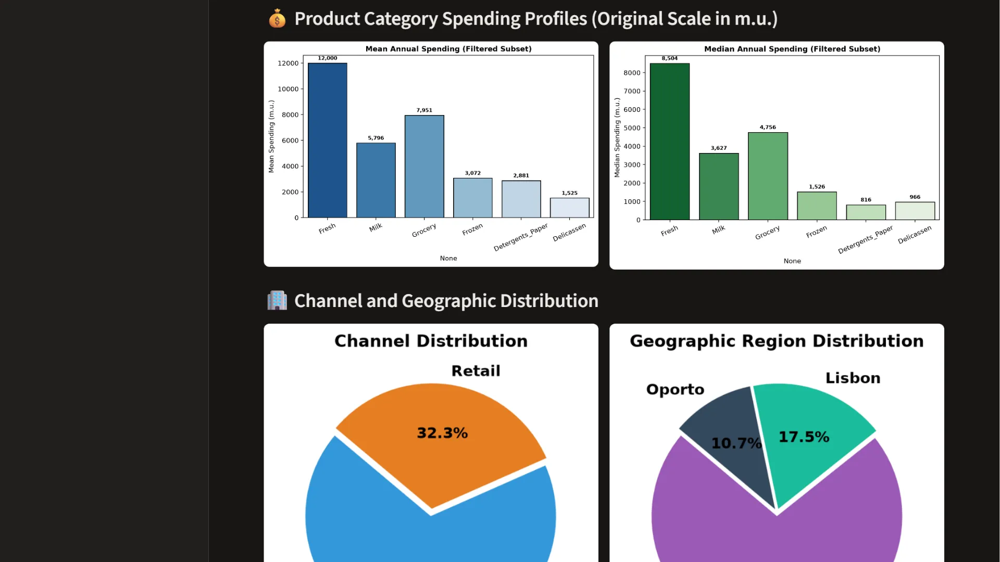
The middle section dynamically renders filtered Mean vs. Median annual spending bar charts in original monetary units alongside Channel (`67.7%` Horeca, `32.3%` Retail) and Geographic Region (`71.8%` Other Region, `17.5%` Lisbon, `10.7%` Oporto) pie distributions.

### 3. Streamlit Dashboard — Customer Explorer & Segment Strategic Playbook
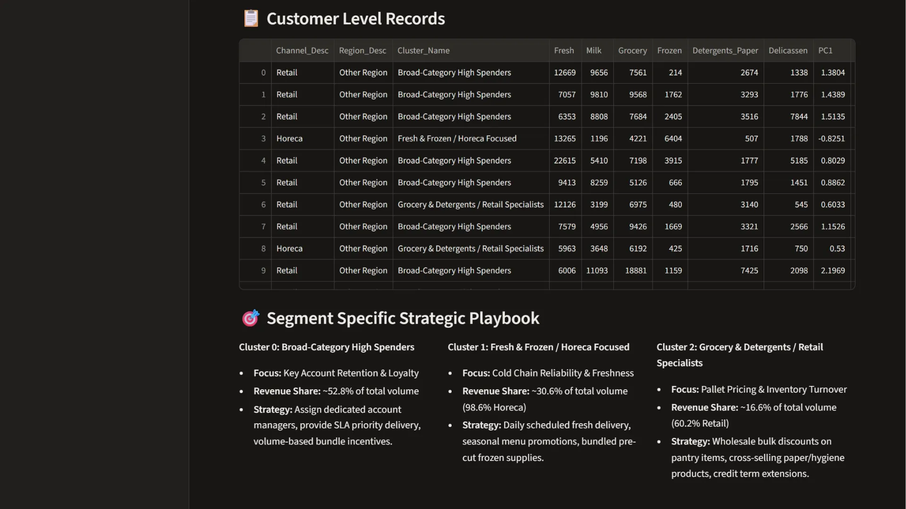
The bottom view provides a searchable, sortable customer-level data explorer (`Channel_Desc`, `Region_Desc`, `Cluster_Name`, six spending categories, `PC1`, `PC2`) paired with a three-column strategic playbook mapping each cluster to tailored retention, cold-chain, and pallet-pricing actions.

### 4. Multi-Metric Model Comparison, Elbow Curve & Silhouette Diagnostics
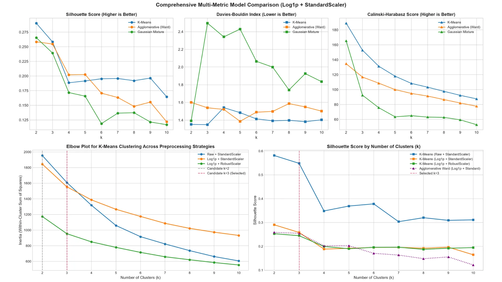
This 5-panel diagnostic grid compares K-Means, Agglomerative (Ward), and Gaussian Mixture across `k = 2..10` on `Log1p + StandardScaler` (top row: Silhouette Score, Davies-Bouldin Index, Calinski-Harabasz Score) and contrasts `Raw + StandardScaler`, `Log1p + StandardScaler`, and `Log1p + RobustScaler` (bottom row: Elbow Inertia and Silhouette curves), illustrating both the raw-data outlier trap and the selection of `k = 3`.

### 5. Raw Annual Spending Distributions & Skewness Analysis
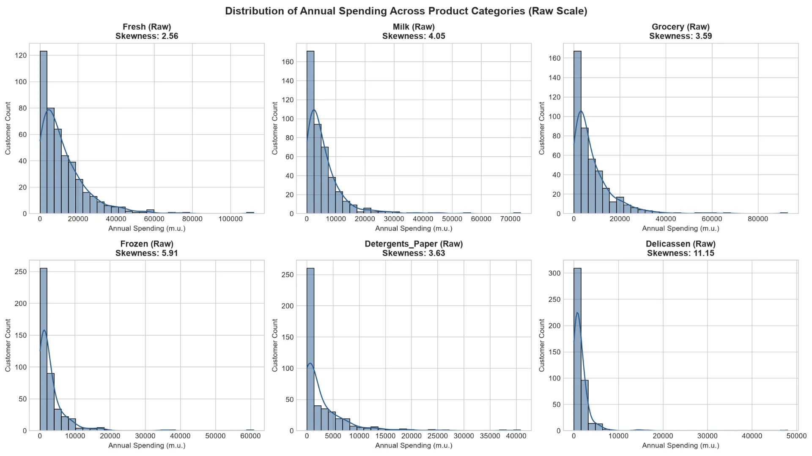
Histograms with KDE overlays across all six product categories expose severe right-skewness (`2.56` for `Fresh`, `4.05` for `Milk`, `3.59` for `Grocery`, `5.91` for `Frozen`, `3.63` for `Detergents_Paper`, and `11.15` for `Delicassen`), justifying non-linear `log1p` compression prior to distance-based clustering.

### 6. 2D PCA Projection Biplot of Customer Clusters
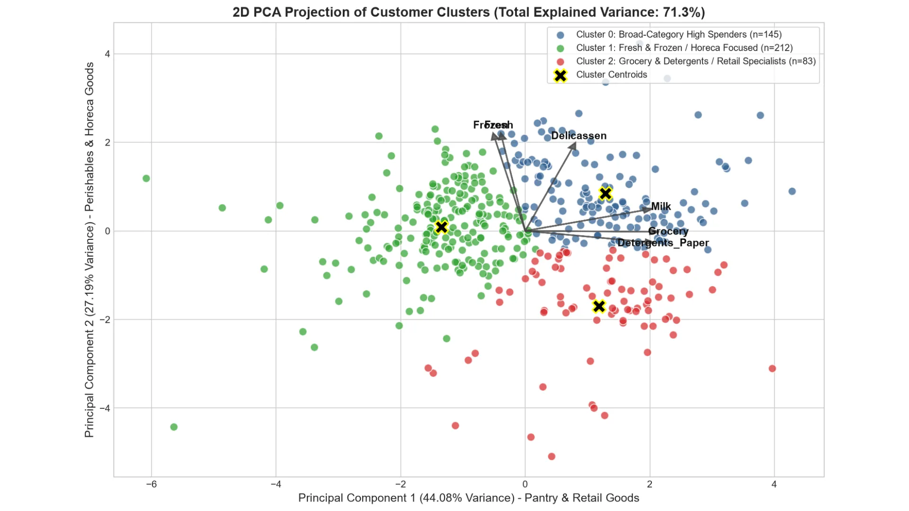
Projecting the `Log1p + StandardScaler` space onto two principal components captures `71.3%` (`71.27%`) of total variance and reveals clear geometric separation around the three K-Means centroids: `PC1` (`44.08%`) aligns with `Grocery`, `Detergents_Paper`, and `Milk`, while `PC2` (`27.19%`) aligns with `Fresh`, `Frozen`, and `Delicassen`.

### 7. Spending Boxplots Before and After Log1p Transformation
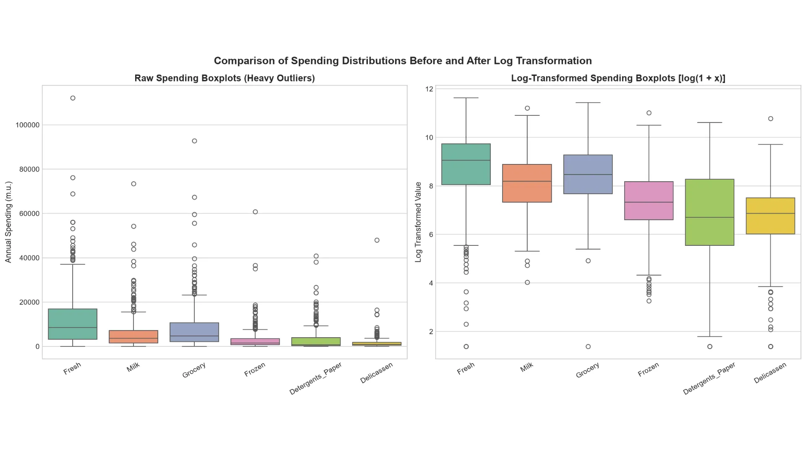
Comparing raw boxplots (left) against `log(1 + x)` boxplots (right) demonstrates how `log1p` stabilizes extreme wholesale spenders exceeding `100,000 m.u.` into balanced interquartile ranges without discarding high-value institutional buyers.

### 8. Channel and Geographic Region Composition Across Segments
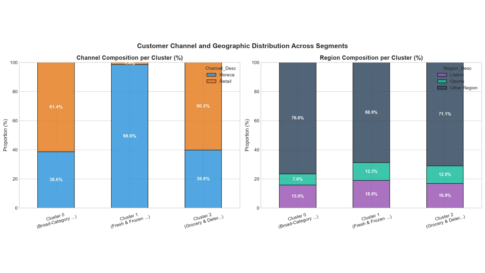
Stacked percentage bar charts show strong channel specialization in `Cluster 1` (`98.6%` Horeca) versus mixed-channel high-volume and pantry-focused profiles in `Cluster 0` (`61.4%` Retail, `38.6%` Horeca) and `Cluster 2` (`60.2%` Retail, `39.8%` Horeca), while geographic region proportions remain broadly consistent across segments (`68.9%–76.6%` Other Region).

### 9. Mean vs. Median Raw-Scale Spending Profiles by Cluster
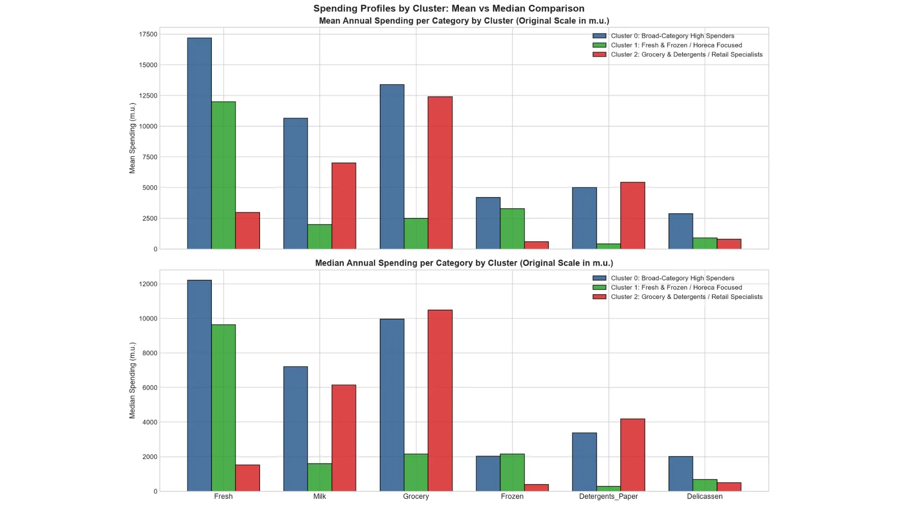
Grouped bar charts in original monetary units confirm that `Cluster 0` leads every spending category in both mean and median terms, `Cluster 1` concentrates heavily in `Fresh` and `Frozen`, and `Cluster 2` rivals `Cluster 0` in `Grocery` and `Detergents_Paper` while purchasing minimal perishables.

### 10. Standardized Z-Score Heatmap & Segment Distribution
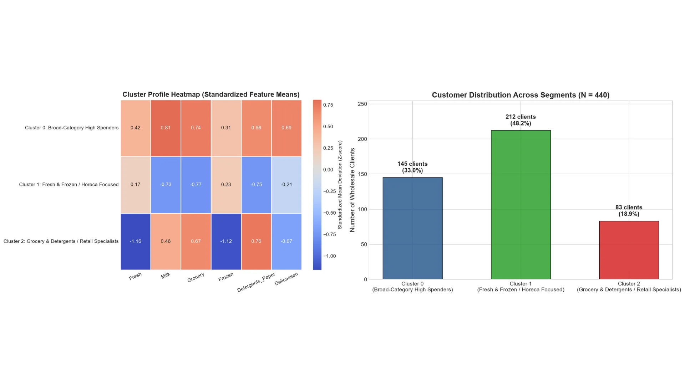
The standardized feature mean heatmap (left) contrasts positive Z-scores across all categories for `Cluster 0` (`+0.31` to `+0.81`) against `Cluster 1`'s negative pantry scores (`-0.73` to `-0.77`) and `Cluster 2`'s deeply negative perishable scores (`-1.16` `Fresh`, `-1.12` `Frozen`), paired with segment counts (`145`, `212`, `83`).

### 11. Correlation Analysis of Raw vs. Log-Transformed Spending Categories
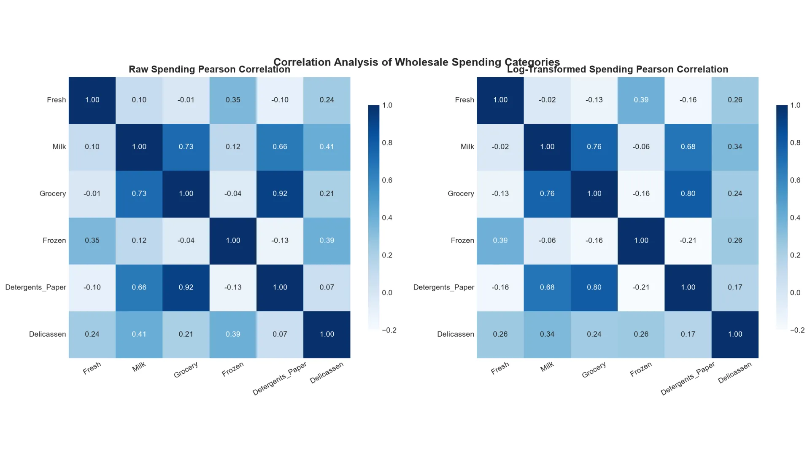
Side-by-side Pearson correlation matrices reveal a strong retail co-purchasing triad among `Grocery`, `Detergents_Paper`, and `Milk` (`r = 0.92` raw / `0.80` log between `Grocery` and `Detergents_Paper`; `r = 0.73` raw / `0.76` log between `Milk` and `Grocery`), contrasted with near-zero or negative correlation against `Fresh` and `Frozen`.

## Prerequisites

- **Operating System:** Windows, macOS, or Linux capable of running Python 3 and a local web browser for Streamlit.
- **Python Runtime:** Python `3.8+` (compatible with all minimum package versions declared in `requirements.txt`).
- **Compute Hardware:** Standard multi-core CPU; no GPU or CUDA acceleration is required (`440 x 6` tabular matrix executes in seconds).
- **Python Dependencies (from `requirements.txt`):** `pandas>=2.0.0`, `numpy>=1.24.0`, `scikit-learn>=1.3.0`, `matplotlib>=3.7.0`, `seaborn>=0.12.0`, `scipy>=1.10.0`, and `streamlit>=1.30.0`.
- **Dataset Access:** Included locally at `dataset/original/Wholesale_Customers.csv` (no external download credentials required).

## Installation & Setup

1. **Clone the repository:**
   ```bash
   git clone https://github.com/weztcy/Wholesale-Customer-Segmentation-Using-K-Means.git
   cd "Wholesale Customer Segmentation Using K-Means"
   ```
2. **Create and activate a virtual environment (recommended):**
   ```bash
   python -m venv .venv
   # Windows (PowerShell)
   .venv\Scripts\Activate.ps1
   # macOS / Linux
   source .venv/bin/activate
   ```
3. **Install dependencies:**
   ```bash
   pip install -r requirements.txt
   ```

## Usage & Execution

The repository supports three execution paths depending on whether you want to regenerate clustering outputs from raw data, explore the analysis interactively in Jupyter, or launch the Streamlit dashboard. Note that `src/clustering.py` looks for `Wholesale_Customers.csv` in the working directory or `dataset/Wholesale_Customers.csv`, whereas the raw CSV in this repository is stored at `dataset/original/Wholesale_Customers.csv` (while precomputed outputs already reside in `dataset/`).

1. **Run the end-to-end clustering & visualization script:**
   If running `src/clustering.py` directly from the repository root, ensure `Wholesale_Customers.csv` is accessible at `dataset/Wholesale_Customers.csv` or the root directory (or call `load_data('dataset/original/Wholesale_Customers.csv')`):
   ```bash
   python -c "import os, shutil; os.path.exists('dataset/Wholesale_Customers.csv') or shutil.copy('dataset/original/Wholesale_Customers.csv', 'dataset/Wholesale_Customers.csv')"
   python src/clustering.py
   ```
   This outputs `model_comparison.csv`, `clustered_customers.csv`, `cluster_profiles.csv`, and 11 `.png` plots under `outputs/`.
2. **Explore step-by-step in Jupyter Notebook:**
   ```bash
   jupyter notebook notebooks/customer_segmentation.ipynb
   ```
3. **Launch the interactive Streamlit dashboard:**
   Run from the repository root so `streamlit/app.py` resolves `dataset/clustered_customers.csv`:
   ```bash
   python -m streamlit run streamlit/app.py
   ```
   Open `http://localhost:8501` in your browser to filter by segment, channel, and region.

## Reproducibility & Execution

All stochastic steps in `src/clustering.py` and `notebooks/customer_segmentation.ipynb` are explicitly seeded (`random_state=42`, `n_init=25` for K-Means, `n_init=10` for GMM, `random_state=42` for 2D PCA) and run against the static 440-row `Wholesale_Customers.csv` snapshot. Because the repository ships precomputed outputs in `dataset/` (`clustered_customers.csv`, `cluster_profiles.csv`, `model_comparison.csv`) and `figures/`, results can be inspected immediately or regenerated deterministically.

1. Verify dependency versions in `requirements.txt` (`scikit-learn>=1.3.0`, `numpy>=1.24.0`, `pandas>=2.0.0`).
2. Confirm input data integrity by hashing or checking row count (`440` rows, `8` columns) of `dataset/original/Wholesale_Customers.csv`.
3. Execute `src/clustering.py` with `random_state=42` to regenerate `model_comparison.csv` (81 rows), `clustered_customers.csv`, `cluster_profiles.csv`, and all 11 figures; note that minor floating-point variations may occur across different BLAS/scikit-learn builds, though cluster assignments (`145 / 212 / 83`) remain stable due to `n_init=25`.

## Contributing

Contributions that improve clustering diagnostics, add out-of-sample stability tests, or extend the Streamlit dashboard are welcome.

1. Fork the repository.
2. Create a feature branch for your change (`git checkout -b feature/your-feature`).
3. Make your changes while keeping `src/clustering.py`, `streamlit/app.py`, and dataset paths consistent.
4. Run `src/clustering.py` and launch `streamlit/app.py` to verify that all outputs and dashboard views render without errors.
5. Commit and push your branch to your fork.
6. Open a pull request with a clear explanation of the changes and verification results.

## License

This project is licensed under the MIT License.
See the [LICENSE](LICENSE) file for details.

## Author & Contact

**Yohanes Dimas Pratama**

- GitHub: [github.com/weztcy](https://github.com/weztcy)
- Portfolio: [yohanesdimas.com](https://yohanesdimas.com)
- LinkedIn: [linkedin.com/in/yohanes-dimas](https://www.linkedin.com/in/yohanes-dimas)
