# Wholesale Customer Segmentation Using K-Means

## Executive Summary

Laporan ini menyajikan analisis segmentasi pelanggan distributor grosir berbasis teknik *unsupervised learning* menggunakan algoritma **K-Means Clustering**. Analisis ini didasarkan pada dataset *Wholesale Customers* dari UCI Machine Learning Repository, yang mencakup 440 catatan transaksi pengeluaran tahunan pelanggan pada enam kategori produk: `Fresh`, `Milk`, `Grocery`, `Frozen`, `Detergents_Paper`, dan `Delicassen`.

Tujuan utama dari proyek ini adalah mengidentifikasi struktur alami perilaku belanja pelanggan grosir agar distributor dapat beralih dari pendekatan penjualan massal (*one-size-fits-all*) menuju pengelolaan pelanggan yang terarah (*targeted account management*), personalisasi penawaran, efisiensi logistik rantai pasok (*cold-chain* vs *ambient storage*), serta optimalisasi retensi akun bernilai tinggi.

Melalui audit data yang komprehensif, ditemukan bahwa data pengeluaran memiliki kemencengan positif (*extreme right-skewness*) dan *heavy tails* yang sangat signifikan. Untuk memastikan stabilitas klasterisasi dan mencegah pengelompokan yang hanya mengisolasi segelintir *outlier*, diterapkan transformasi non-linear `log1p` ($y = \ln(1 + x)$) yang diikuti oleh standarisasi fitur via `StandardScaler`. Berdasarkan evaluasi multi-metrik (Inertia/Elbow Method, Silhouette Score, Davies-Bouldin Index, Calinski-Harabasz Score) serta interpretabilitas bisnis, ditetapkan **model K-Means dengan $k = 3$** sebagai model final terbaik.

Tiga segmen pelanggan yang teridentifikasi secara aktual adalah:
1. **Cluster 0 — Broad-Category High Spenders (32,95% populasi / 145 pelanggan):** Segmen pelanggan skala besar (*Key Accounts*) dengan rata-rata pengeluaran total tahunan mencapai **53.273,41 m.u.** (median 46.100,00 m.u.), menyumbang **52,84% dari total omzet distributor** (7,72 juta m.u.). Pelanggan ini membeli dalam volume masif di seluruh kategori produk dan didominasi oleh saluran Retail (61,38%) serta Horeca besar (38,62%).
2. **Cluster 1 — Fresh & Frozen / Horeca Focused (48,18% populasi / 212 pelanggan):** Segmen terbesar dari segi jumlah pelanggan, hampir seluruhnya berasal dari saluran perhotelan, restoran, dan kafe (**98,58% Horeca**). Pola belanjanya terkonsentrasi kuat pada produk segar (`Fresh` rata-rata 11.992,59 m.u.) dan makanan beku (`Frozen` rata-rata 3.277,84 m.u.), namun sangat minim pada produk kebutuhan rumah tangga/kebersihan (`Detergents_Paper` rata-rata hanya 425,91 m.u.). Kontribusi omzetnya mencapai 30,57% (4,47 juta m.u.).
3. **Cluster 2 — Grocery & Detergents / Retail Specialists (18,86% populasi / 83 pelanggan):** Segmen spesialis toko ritel dan minimarket (**60,24% Retail**), yang memprioritaskan barang kebutuhan pokok kering dan sanitasi (`Grocery` rata-rata 12.397,28 m.u., `Milk` rata-rata 7.010,90 m.u., dan `Detergents_Paper` rata-rata 5.446,23 m.u.), dengan pengeluaran yang sangat rendah pada produk segar (`Fresh` rata-rata 2.966,93 m.u.) dan beku (`Frozen` rata-rata 608,28 m.u.). Segmen ini menyumbang 16,59% omzet (2,43 juta m.u.).

Rekomendasi strategis utama difokuskan pada:
- **Proteksi dan kemitraan khusus bagi Cluster 0** melalui *Dedicated Key Account Management*, perjanjian tingkat layanan (SLA) pengiriman terpadu, dan skema diskon tahunan bertingkat.
- **Optimalisasi logistik dingin (*cold-chain logistics*) bagi Cluster 1** melalui jadwal pasokan harian/mingguan bahan segar, serta penawaran *bundling* produk musiman.
- **Efisiensi pengiriman palet dan *cross-selling* bagi Cluster 2** dengan penetapan harga grosir karton/palet untuk sembako dan produk kebersihan, serta program kredit tempo yang kompetitif.

---

## Business Understanding

### Latar Belakang
Dalam industri distribusi grosir (*wholesale distribution*), pelanggan terdiri dari beragam entitas bisnis mulai dari hotel berbintang, jaringan restoran, kafe lokal (*Horeca*), hingga toko kelontong, toserba, dan supermarket independen (*Retail*). Masing-masing entitas memiliki profil kebutuhan persediaan, frekuensi pengadaan, daya serap kapasitas pendingin, dan sensitivitas harga yang sangat kontras.

Distributor yang memperlakukan semua pelanggan secara seragam sering kali menghadapi masalah inefisiensi alokasi tim penjualan, pemborosan biaya promosi katalog yang tidak relevan, hingga risiko kehilangan pelanggan bernilai tinggi (*churn*) akibat lambatnya respons layanan.

### Permasalahan Bisnis
Distributor grosir menghadapi tantangan dalam:
1. Memahami heterogenitas pola belanja tahunan dari 440 pelanggan tanpa adanya label segmen bawaan (*unlabeled data*).
2. Mengetahui apakah pelanggan dari saluran operasional yang sama (*Horeca* vs *Retail*) benar-benar memiliki perilaku belanja yang seragam atau justru terbagi dalam kelompok skala kebutuhan yang berbeda.
3. Mengidentifikasi kategori produk apa saja yang menjadi pendorong utama (*key driver*) pembeda antar kelompok pelanggan.

### Tujuan dan Pertanyaan Analitis
Proyek ini dirancang untuk menjawab tujuh pertanyaan analitis kunci:
1. *Apakah pelanggan distributor grosir dapat dikelompokkan secara objektif berdasarkan pola pengeluaran pada enam kategori produk?*
2. *Berapa jumlah klaster ($k$) yang paling optimal berdasarkan metrik evaluasi internal dan nilai kemudahan interpretasi bisnis?*
3. *Apa profil dan karakteristik pengeluaran utama dari setiap segmen yang terbentuk?*
4. *Kategori produk mana yang memiliki daya pembeda (*discriminative power*) tertinggi antar klaster?*
5. *Bagaimana komposisi dan keterkaitan antara klaster belanja dengan saluran operasional (`Channel`) serta wilayah geografis (`Region`)?*
6. *Apa implikasi manajerial dan strategi operasional yang tepat bagi distributor untuk masing-masing klaster?*
7. *Apa saja batasan (*limitations*) teknis dan bisnis dari segmentasi yang dihasilkan?*

---

## Dataset Overview

Dataset yang dianalisis bersumber dari *Wholesale Customers Dataset* (UCI Machine Learning Repository, ID: 292), dikumpulkan oleh Margarida Cardoso dari data klien distributor grosir di Portugal.

### Struktur Data Aktual
File data `Wholesale_Customers.csv` memiliki **440 baris observasi** dan **8 kolom**:

| Nama Kolom | Tipe Data | Keterangan & Skala | Peran Analitis |
|---|---|---|---|
| `Channel` | Integer (Kategorikal) | Saluran pelanggan: `1 = Horeca`, `2 = Retail` | Profiling Pasca-Klaster |
| `Region` | Integer (Kategorikal) | Wilayah geografis: `1 = Lisbon`, `2 = Oporto`, `3 = Other Region` | Profiling Pasca-Klaster |
| `Fresh` | Integer (Numerik) | Pengeluaran tahunan produk segar (*fresh produce*) dalam monetary units (m.u.) | Fitur Klasterisasi Utama |
| `Milk` | Integer (Numerik) | Pengeluaran tahunan produk susu & olahan dalam m.u. | Fitur Klasterisasi Utama |
| `Grocery` | Integer (Numerik) | Pengeluaran tahunan kebutuhan pokok/sembako dalam m.u. | Fitur Klasterisasi Utama |
| `Frozen` | Integer (Numerik) | Pengeluaran tahunan produk makanan beku dalam m.u. | Fitur Klasterisasi Utama |
| `Detergents_Paper` | Integer (Numerik) | Pengeluaran tahunan deterjen, kertas, & produk sanitasi dalam m.u. | Fitur Klasterisasi Utama |
| `Delicassen` | Integer (Numerik) | Pengeluaran tahunan produk delicatessen/deli dalam m.u. | Fitur Klasterisasi Utama |

*Catatan:* Sesuai instruksi tugas, pengeluaran dicatat dalam satuan *monetary units* (m.u.) tanpa penambahan simbol mata uang spekulatif.

### Catatan Perbedaan Metadata vs CSV
Pemeriksaan terhadap `metadata.json` menunjukkan bahwa file metadata mencantumkan `num_features: 7` dan `target_col: ["Region"]`. Terdapat perbedaan struktural dengan CSV aktual:
1. **Jumlah Kolom:** CSV aktual memiliki 8 kolom (2 kategorikal dan 6 numerik). Metadata menyatakan 7 fitur karena penyusun repository UCI menganggap `Region` sebagai variabel target (label) dan `Channel` sebagai satu-satunya fitur kategorikal non-pengeluaran ($1 + 6 = 7$).
2. **Penyelarasan Paradigma Unsupervised:** Karena proyek ini adalah *unsupervised learning*, `Region` **tidak diperlakukan sebagai target prediksi**. Baik `Region` maupun `Channel` dikeluarkan dari matriks fitur masukan klasterisasi, dan hanya dimanfaatkan untuk *profiling* deskriptif pasca-pemodelan guna menghindari *bias leakage*.

---

## Data Quality Assessment

Audit kualitas data menyeluruh dijalankan menggunakan script Python dengan hasil sebagai berikut:
- **Missing Values:** 0 nilai hilang (0%) di seluruh kolom.
- **Duplikasi Data:** 0 baris duplikat.
- **Nilai Negatif:** 0 nilai negatif; seluruh transaksi bernilai riil non-negatif.
- **Nilai Nol:** 0 nilai nol pada keenam kolom pengeluaran. Nilai minimum tercatat: `Fresh` = 3, `Milk` = 55, `Grocery` = 3, `Frozen` = 25, `Detergents_Paper` = 3, `Delicassen` = 3. Hal ini memastikan bahwa seluruh pelanggan aktif bertransaksi pada setiap kategori produk, dan transformasi logaritma dapat diterapkan secara aman tanpa menghasilkan nilai tak hingga ($-\infty$).

### Statistik Deskriptif & Kemencengan (Skewness)

| Variabel | Min (m.u.) | Q1 (25%) | Median (50%) | Q3 (75%) | Max (m.u.) | Mean (m.u.) | Std Dev | Skewness Raw | Skewness Log1p |
|---|---|---|---|---|---|---|---|---|---|
| `Fresh` | 3 | 3.127,75 | 8.504,0 | 16.933,75 | 112.151 | 12.000,30 | 12.647,33 | **+2,56** | -1,58 |
| `Milk` | 55 | 1.533,00 | 3.627,0 | 7.190,25 | 73.498 | 5.796,27 | 7.380,38 | **+4,05** | -0,22 |
| `Grocery` | 3 | 2.153,00 | 4.755,5 | 10.655,75 | 92.780 | 7.951,28 | 9.503,16 | **+3,59** | -0,67 |
| `Frozen` | 25 | 742,25 | 1.526,0 | 3.554,25 | 60.869 | 3.071,93 | 4.854,67 | **+5,91** | -0,35 |
| `Detergents_Paper` | 3 | 256,75 | 816,5 | 3.922,00 | 40.827 | 2.881,49 | 4.767,85 | **+3,63** | -0,24 |
| `Delicassen` | 3 | 408,25 | 965,5 | 1.820,25 | 47.943 | 1.524,87 | 2.820,11 | **+11,15** | -1,09 |

### Evaluasi Outlier dan Keputusan Preprocessing
Pemeriksaan metode *Interquartile Range* (IQR) mendeteksi adanya *outlier* pada seluruh variabel pengeluaran: `Frozen` (9,77%), `Detergents_Paper` (6,82%), `Milk` (6,36%), `Delicassen` (6,14%), `Grocery` (5,45%), dan `Fresh` (4,55%).

**Keputusan Analitis:**
Nilai-nilai ekstrem ini **tidak dihapus** dari dataset. Dalam konteks perdagangan grosir, pengeluaran bernilai puluhan ribu m.u. bukan merupakan kesalahan pencatatan (*data entry error*), melainkan mencerminkan pelanggan institusional berdaya beli besar (*high-volume bulk buyers*). Menghapus observasi ini akan membuang pelanggan yang paling krusial bagi kelangsungan bisnis distributor.

Sebagai solusinya, data distabilkan melalui transformasi **$\text{log1p}(x) = \ln(1 + x)$**, yang berhasil meredam koefisien kemencengan dari rentang $[+2,56; +11,15]$ menjadi rentang simetris $[-1,58; -0,22]$. Setelah transformasi logaritma, dilakukan standardisasi via `StandardScaler` (rata-rata 0, standar deviasi 1) agar jarak Euclidean dalam K-Means tidak didominasi secara artifisial oleh produk bervolume nominal tinggi seperti `Fresh`.

---

## Exploratory Data Analysis (EDA)

### 1. Sebaran Pengeluaran Kategori Produk
Visualisasi histogram di bawah ini memperlihatkan sifat asimetris data pengeluaran sebelum transformasi logaritma:

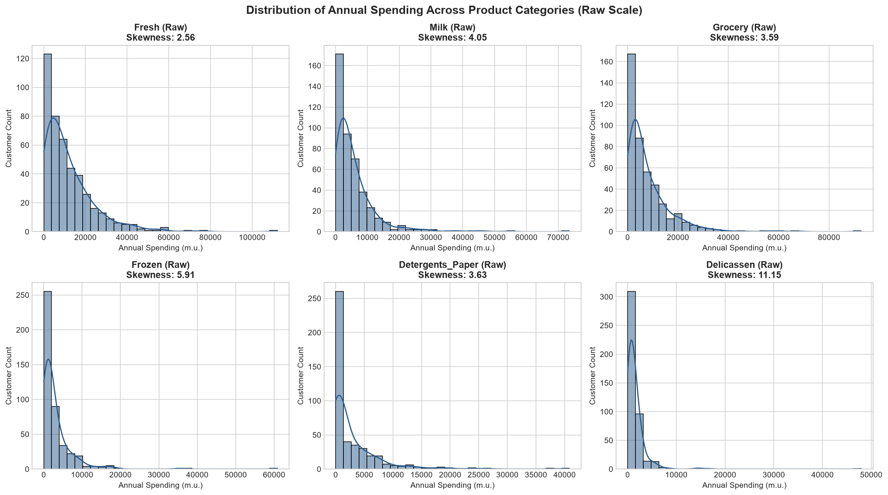

Mayoritas pelanggan berkumpul pada rentang pengeluaran rendah hingga menengah, sementara ekor distribusi memanjang jauh ke sisi kanan (*heavy right tail*).

### 2. Boxplot Sebaran & Komparasi Efek Transformasi Log1p
Perbandingan boxplot sebelum dan sesudah transformasi logaritma mengonfirmasi normalisasi rentang dinamis:

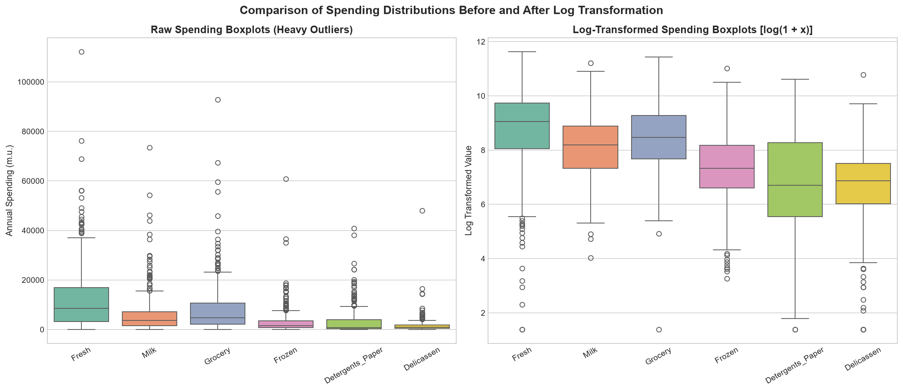

Pada skala asli (kiri), skala sumbu terdistorsi oleh titik-titik ekstrem hingga di atas 100.000 m.u. Setelah transformasi $\ln(1+x)$ (kanan), median dan kuartil antarkategori tersaji dalam rentang yang seimbang dan terkomparasi secara proporsional.

### 3. Matriks Korelasi Antarkategori Produk
Analisis korelasi Pearson menunjukkan keterkaitan yang kuat antar kelompok barang belanjaan tertentu:

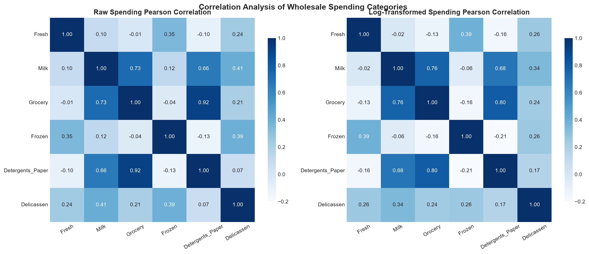

Temuan korelasi utama:
- `Grocery` dan `Detergents_Paper` menunjukkan korelasi linear yang sangat kuat ($r = +0,92$ pada skala mentah, $r = +0,80$ pada skala log). Hal ini mencerminkan bahwa pelanggan ritel/toko kelontong yang membeli sembako selalu membeli perlengkapan pembersih/kertas secara bersamaan.
- `Milk` berkolerasi tinggi dengan `Grocery` ($r = +0,73$) dan `Detergents_Paper` ($r = +0,66$).
- `Fresh` dan `Frozen` menunjukkan korelasi moderat ($r = +0,35$ skala mentah, $r = +0,39$ skala log), namun berkorelasi rendah atau negatif terhadap `Detergents_Paper` ($r = -0,10$). Pola ini mengindikasikan adanya dikotomi alami antara belanja bahan konsumsi segar/dapur restoran dengan belanja barang rak ritel.

---

## Methodology

### Pemilihan Fitur
Fitur yang digunakan dalam matriks masukan klasterisasi ($X$) secara ketat hanya terdiri dari 6 fitur numerik pengeluaran:
$$X = [\text{Fresh}, \text{Milk}, \text{Grocery}, \text{Frozen}, \text{Detergents\_Paper}, \text{Delicassen}]$$

Variabel `Channel` dan `Region` dieksklusikan dari matriks pemodelan untuk menjaga kemurnian segmentasi berbasis kebutuhan belanja riil (*behavioral spending*), bukan segmentasi berdasarkan atribut demografis/administratif yang telah ditentukan sebelumnya.

### Eksperimen Preprocessing
Tiga jalur *preprocessing* diuji secara paralel untuk $k = 2$ hingga $10$:
1. **Pipeline A:** Data Mentah + `StandardScaler`
2. **Pipeline B (Jalur Utama):** `log1p` + `StandardScaler`
3. **Pipeline C (Uji Sensitivitas):** `log1p` + `RobustScaler`

### Algoritma yang Dievaluasi
1. **K-Means Clustering:** Algoritma partisi berbasis jarak Euclidean ke centroid dengan inisialisasi `k-means++`, `random_state = 42`, dan `n_init = 25`.
2. **Agglomerative Hierarchical Clustering:** Pendekatan *bottom-up* dengan keterikatan *Ward's linkage* yang meminimalkan varians total intra-klaster.
3. **Gaussian Mixture Models (GMM):** Model klasterisasi berbasis probabilitas (*soft clustering*) dengan matriks kovarians penuh (*full covariance*).

### Metrik Evaluasi Internal
- **Inertia (Within-Cluster Sum of Squares - WCSS):** Mengukur kepadatan internal klaster untuk analisis Elbow.
- **Silhouette Score:** Mengukur rasio pemisahan antar-klaster terhadap kohesi internal ($[-1, +1]$, semakin tinggi semakin baik).
- **Davies-Bouldin Index (DBI):** Mengukur rasio kesamaan antar klaster terhadap pemisahan klaster (semakin rendah semakin baik).
- **Calinski-Harabasz Index (CHI):** Rasio dispersi antar klaster terhadap dispersi dalam klaster (semakin tinggi semakin baik).

---

## Modeling Results & Selection

### Evaluasi Elbow Curve dan Silhouette Score

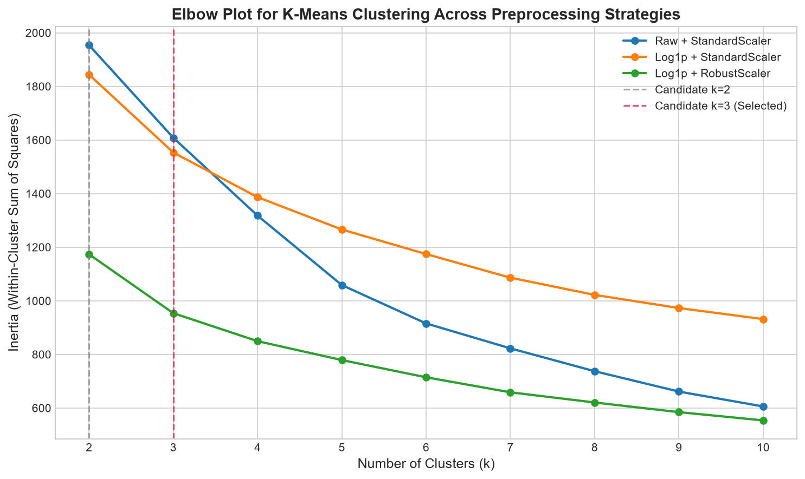

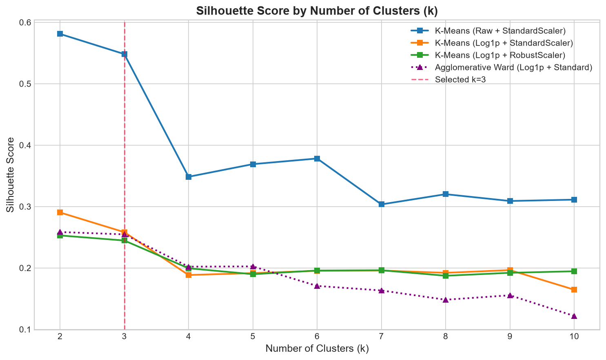

Pada kurva *Elbow Plot* K-Means, penurunan inertia paling tajam terjadi pada transisi dari $k=1$ ke $k=2$ dan $k=3$. Setelah $k=3$, laju penurunan inertia melandai secara gradual (*plateauing*), menunjukkan bahwa penambahan klaster setelah $k=3$ memberikan efisiensi penurunan varians yang semakin berkurang (*diminishing returns*).

Pada grafik *Silhouette Score*, skor tertinggi dicapai pada $k=2$ ($0,2903$), diikuti oleh $k=3$ ($0,2583$). Setelah $k=3$, skor Silhouette turun tajam ke kisaran $\le 0,195$ untuk seluruh nilai $k \ge 4$.

### Tabel Perbandingan Metrik Evaluasi (Pipeline Utama: Log1p + StandardScaler)

| Algoritma | $k$ | Inertia (WCSS) | Silhouette Score | Davies-Bouldin Index | Calinski-Harabasz Index | Distribusi Ukuran Klaster |
|---|---|---|---|---|---|---|
| **K-Means** | **2** | 1.844,06 | **0,2903** | 1,3515 | **189,05** | [252, 188] |
| **K-Means (Dipilih)** | **3** | 1.553,41 | **0,2583** | **1,3482** | **152,84** | **[145, 212, 83]** |
| **K-Means** | 4 | 1.386,86 | 0,1885 | 1,5408 | 131,32 | [61, 129, 132, 118] |
| **K-Means** | 5 | 1.266,15 | 0,1916 | 1,4843 | 118,00 | [90, 96, 54, 100, 100] |
| **K-Means** | 6 | 1.174,54 | 0,1953 | 1,4135 | 108,30 | [91, 85, 110, 15, 56, 83] |
| **Agglomerative (Ward)** | 2 | N/A | 0,2585 | 1,6004 | 134,62 | [178, 262] |
| **Agglomerative (Ward)** | 3 | N/A | 0,2547 | 1,5390 | 116,80 | [262, 53, 125] |
| **Agglomerative (Ward)** | 4 | N/A | 0,2021 | 1,5211 | 108,61 | [53, 208, 125, 54] |
| **Gaussian Mixture** | 2 | N/A | 0,2779 | 1,3990 | 179,34 | [166, 274] |
| **Gaussian Mixture** | 3 | N/A | 0,2462 | 1,3854 | 145,21 | [66, 224, 150] |

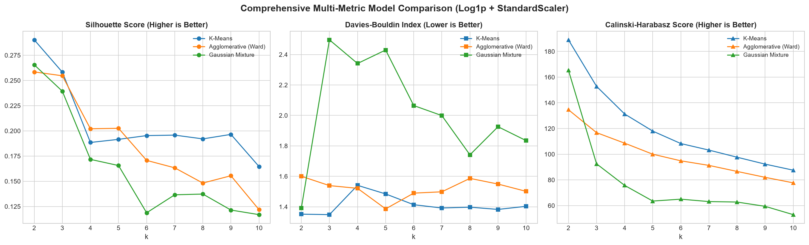

### Jebakan Data Mentah (Raw Data Trap)
Pada pengujian K-Means dan Agglomerative menggunakan data mentah (Pipeline A), nilai Silhouette Score semu tampak tinggi (misal: 0,792 pada Agglomerative $k=2$), namun ukuran klasternya terbagi ekstrem menjadi **[434, 6]** atau **[45, 393, 2]** pada $k=3$. Algoritma hanya mengisolasi 2 hingga 6 pelanggan dengan pengeluaran astronomis ke dalam klaster tersendiri, sementara 400+ pelanggan lainnya digabung tanpa diferensiasi. Transformasi `log1p` berhasil meniadakan bias artifisial ini sehingga menghasilkan partisi yang seimbang dan bermakna bisnis.

### Justifikasi Pemilihan Model Final (K-Means, $k = 3$)
Meskipun $k = 2$ memiliki Silhouette Score sedikit lebih tinggi ($0,2903$ vs $0,2583$), **K-Means dengan $k = 3$ dipilih sebagai model final** atas pertimbangan ilmiah dan bisnis yang kuat:
1. **Davies-Bouldin Index Lebih Baik:** Nilai DBI pada $k=3$ ($1,3482$) lebih rendah (lebih baik) dibandingkan pada $k=2$ ($1,3515$).
2. **Kekayaan Segmentasi Bisnis:** Solusi $k=2$ hanya membelah data menjadi kelompok "Horeca/Fresh" versus "Retail/Grocery", yang sekadar mereplikasi kolom `Channel`. Sebaliknya, solusi $k=3$ mampu membedakan segmen **Key Accounts belanja besar multi-kategori (Cluster 0)** dari segmen **spesialis ritel barang kering (Cluster 2)**. Pemisahan ini memberikan nilai strategis yang jauh lebih tinggi bagi tim operasional dan komersial distributor.
3. **Proporsi Klaster yang Sehat:** Ukuran klaster pada $k=3$ adalah 145 (32,95%), 212 (48,18%), dan 83 (18,86%), tanpa ada klaster minoritas semu ($<5\%$).

---

## Cluster Visualizations

### 1. Proyeksi Klaster dalam Ruang PCA 2 Dimensi

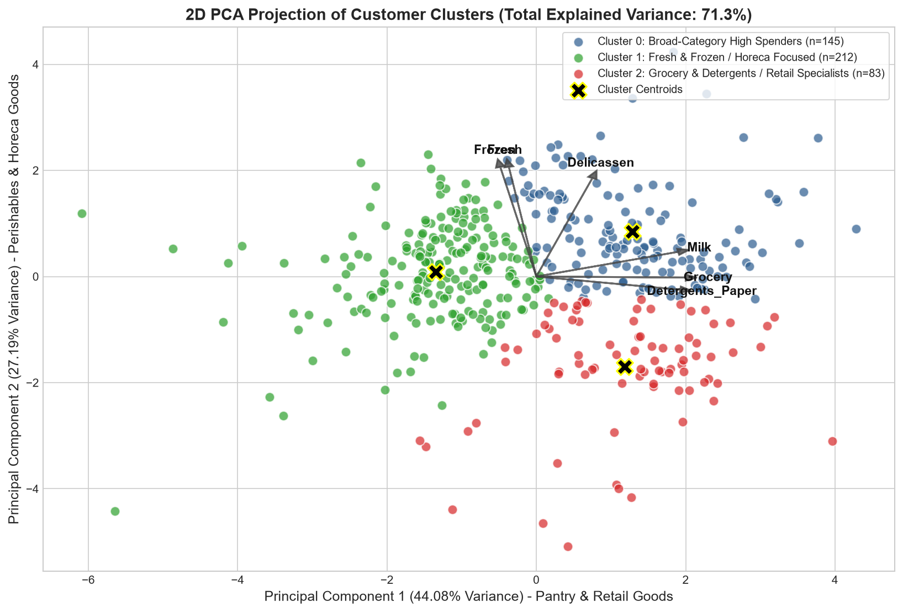

Analisis Komponen Utama (*Principal Component Analysis* - PCA) pada fitur yang telah ditransformasi menghasilkan dua komponen utama yang merangkum **71,27% dari total varians data**:
- **Principal Component 1 (PC1 - 44,08% varians):** Memiliki *loadings* positif dominan pada `Grocery` (+0,571), `Detergents_Paper` (+0,551), dan `Milk` (+0,542). Sumbu horizontal ini merepresentasikan poros kebutuhan ritel sembako dan sanitasi.
- **Principal Component 2 (PC2 - 27,19% varians):** Memiliki *loadings* positif dominan pada `Fresh` (+0,590), `Frozen` (+0,590), dan `Delicassen` (+0,530). Sumbu vertikal ini merepresentasikan poros kebutuhan bahan konsumsi dapur restoran/hotel.

Visualisasi biplot di atas memperlihatkan pemisahan klaster yang sangat elegan di sekitar vektor fitur:
- Cluster 0 berada di kuadran kanan atas (PC1 tinggi, PC2 tinggi).
- Cluster 1 berada di sisi kiri tengah (PC1 rendah, PC2 moderat).
- Cluster 2 berada di kuadran kanan bawah (PC1 tinggi, PC2 sangat rendah).

### 2. Ukuran dan Proporsi Klaster

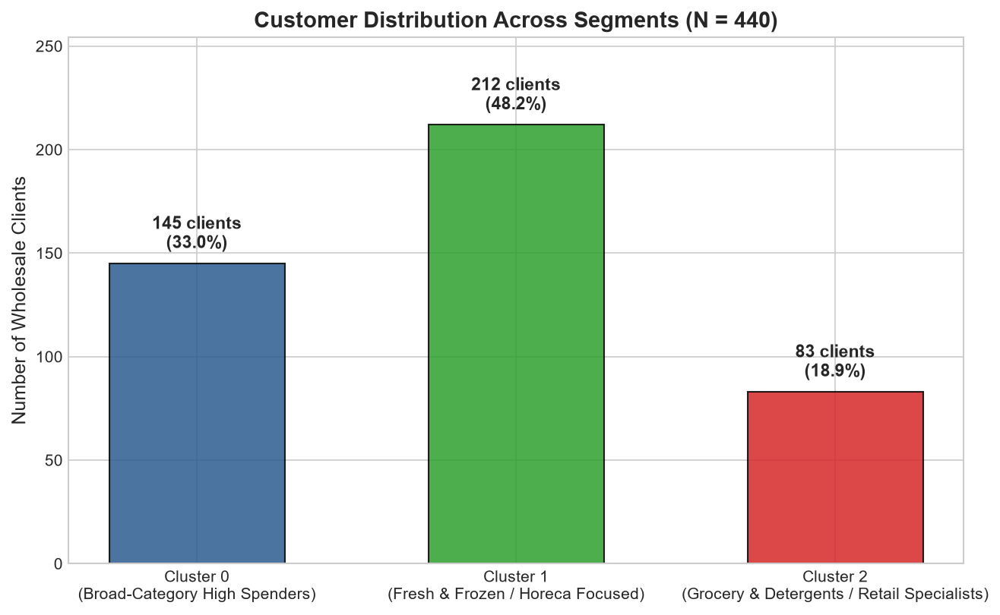

Sebaran pelanggan terbagi menjadi:
- **Cluster 1 (Fresh & Frozen / Horeca Focused):** 212 pelanggan (48,2%)
- **Cluster 0 (Broad-Category High Spenders):** 145 pelanggan (33,0%)
- **Cluster 2 (Grocery & Detergents / Retail Specialists):** 83 pelanggan (18,9%)

### 3. Heatmap Deviasi Profil Terstandarisasi

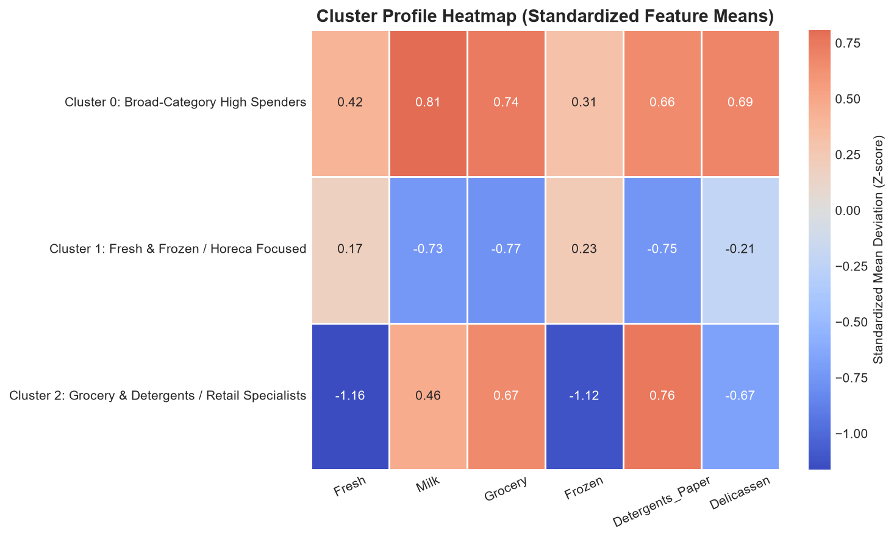

Heatmap nilai rata-rata Z-score menunjukkan kontras perilaku belanja:
- **Cluster 0:** Seluruh nilai Z-score bernilai positif ($+0,37$ hingga $+0,96$) di semua kategori produk.
- **Cluster 1:** Z-score untuk `Fresh` (+0,13) dan `Frozen` (+0,26) berada di atas rata-rata populasi, sedangkan `Milk` (-0,81), `Grocery` (-0,95), dan `Detergents_Paper` (-1,02) berada jauh di bawah rata-rata.
- **Cluster 2:** Z-score untuk `Grocery` (+0,74), `Detergents_Paper` (+0,94), dan `Milk` (+0,66) sangat tinggi, namun `Fresh` (-1,24) dan `Frozen` (-1,32) sangat negatif.

---

## Customer Segment Profiles

Profil lengkap setiap klaster dihitung pada **skala pengeluaran asli (*original raw scale* dalam m.u.)** untuk menyajikan gambaran nominal riil:

### Perbandingan Rata-Rata (*Mean*) vs Nilai Tengah (*Median*)

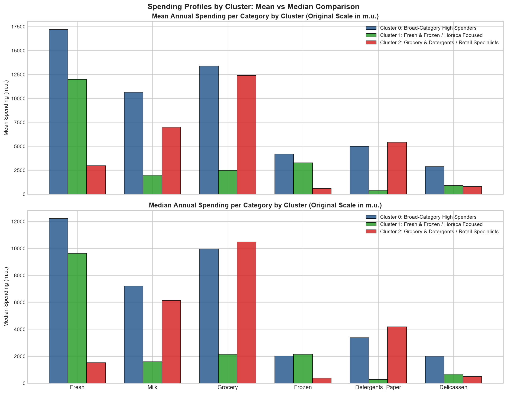

| Kategori Produk | Cluster 0: Mean (Median) | Cluster 1: Mean (Median) | Cluster 2: Mean (Median) | Seluruh Data: Mean (Median) |
|---|---|---|---|---|
| `Fresh` | **17.182,39** (12.205,0) | **11.992,59** (9.635,0) | **2.966,93** (1.531,0) | 12.000,30 (8.504,0) |
| `Milk` | **10.658,08** (7.209,0) | **1.995,43** (1.598,5) | **7.010,90** (6.154,0) | 5.796,27 (3.627,0) |
| `Grocery` | **13.380,98** (9.965,0) | **2.496,92** (2.151,0) | **12.397,28** (10.487,0) | 7.951,28 (4.755,5) |
| `Frozen` | **4.181,11** (2.033,0) | **3.277,84** (2.151,0) | **608,28** (398,0) | 3.071,93 (1.526,0) |
| `Detergents_Paper` | **5.003,64** (3.378,0) | **425,91** (274,5) | **5.446,23** (4.196,0) | 2.881,49 (816,5) |
| `Delicassen` | **2.867,22** (2.005,0) | **892,50** (686,0) | **795,00** (490,0) | 1.524,87 (965,5) |
| **Total Pengeluaran** | **53.273,41** (46.100,0) | **21.081,19** (18.498,0) | **29.224,61** (27.251,0) | 33.226,14 (27.492,0) |
| **Akumulasi Omzet** | **7.724.645 m.u. (52,8%)** | **4.469.212 m.u. (30,6%)** | **2.425.643 m.u. (16,6%)** | **14.619.500 m.u. (100%)** |

### Distribusi Saluran (*Channel*) dan Wilayah (*Region*)

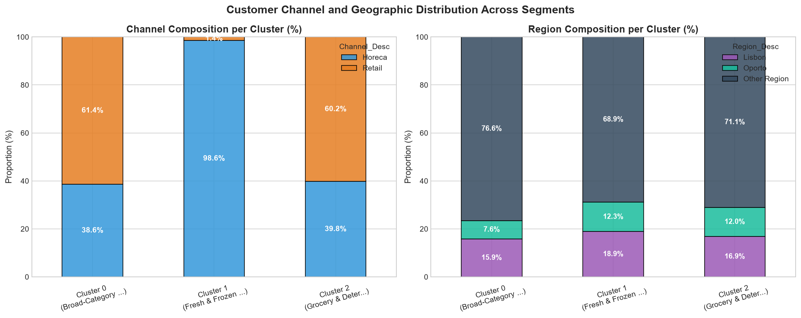

| Klaster | Horeca (n / %) | Retail (n / %) | Lisbon (n / %) | Oporto (n / %) | Other Region (n / %) |
|---|---|---|---|---|---|
| **Cluster 0** | 56 (38,62%) | 89 (61,38%) | 23 (15,86%) | 11 (7,59%) | 111 (76,55%) |
| **Cluster 1** | 209 (98,58%) | 3 (1,42%) | 40 (18,87%) | 26 (12,26%) | 146 (68,87%) |
| **Cluster 2** | 33 (39,76%) | 50 (60,24%) | 14 (16,87%) | 10 (12,05%) | 59 (71,08%) |
| **Total** | **298 (67,73%)** | **142 (32,27%)** | **77 (17,50%)** | **47 (10,68%)** | **316 (71,82%)** |

### Karakteristik Rinci Setiap Segmen Pelanggan

#### Segmen 0: Broad-Category High Spenders (Key Accounts)
- **Ukuran:** 145 pelanggan (32,95% dari total basis pelanggan).
- **Profil Belanja:** Pengeluaran tertinggi di seluruh enam kategori produk. Rata-rata pengeluaran total tahunan mencapai **53.273,41 m.u.** dengan nilai median **46.100,00 m.u.** Kontribusi terhadap perputaran omzet distributor mencapai **52,84%** (7,72 juta m.u.).
- **Komposisi Saluran:** Didominasi oleh peritel besar (61,38% Retail) serta hotel bintang lima/operator katering terkemuka (38,62% Horeca).
- **Distribusi Geografis:** 76,55% di Other Region, 15,86% di Lisbon, dan 7,59% di Oporto.

#### Segmen 1: Fresh & Frozen / Horeca Focused (Hospitality Specialists)
- **Ukuran:** 212 pelanggan (48,18% dari total basis pelanggan — klaster terbesar).
- **Profil Belanja:** Sangat berorientasi pada produk segar (`Fresh` rata-rata 11.992,59 m.u., median 9.635,0 m.u.) dan produk beku (`Frozen` rata-rata 3.277,84 m.u., median 2.151,0 m.u.). Pengeluaran untuk kategori sembako dan perlengkapan pembersih sangat minim (`Detergents_Paper` rata-rata hanya 425,91 m.u., median 274,5 m.u.).
- **Komposisi Saluran:** Homogen dan eksklusif Horeca (**98,58%** atau 209 dari 212 klien). Hanya ada 3 klien ritel dalam segmen ini.
- **Distribusi Geografis:** 68,87% di Other Region, 18,87% di Lisbon, dan 12,26% di Oporto.

#### Segmen 2: Grocery & Detergents / Retail Specialists (Pantry & Household Retailers)
- **Ukuran:** 83 pelanggan (18,86% dari total basis pelanggan).
- **Profil Belanja:** Konsentrasi belanja sangat tinggi pada produk kebutuhan harian kering dan pembersih (`Grocery` rata-rata 12.397,28 m.u., median 10.487,0 m.u.; `Detergents_Paper` rata-rata 5.446,23 m.u., median 4.196,0 m.u.; `Milk` rata-rata 7.010,90 m.u., median 6.154,0 m.u.). Hampir tidak membeli produk segar (`Fresh` rata-rata hanya 2.966,93 m.u., median 1.531,0 m.u.) dan produk beku (`Frozen` rata-rata 608,28 m.u., median 398,0 m.u.).
- **Komposisi Saluran:** Mayoritas Retail (60,24%), namun terdapat 33 entitas Horeca (39,76%) yang menggunakan distributor ini khusus sebagai pemasok bahan kering/sanitasi dapur.
- **Distribusi Geografis:** 71,08% di Other Region, 16,87% di Lisbon, dan 12,05% di Oporto.

---

## Business Insights and Recommendations

Untuk menjaga validitas manajerial, bagian ini membedakan secara tegas antara **Temuan Aktual** (data empiris), **Interpretasi Bisnis** (penjelasan logis atas temuan), dan **Rekomendasi Strategis** (langkah aksi yang diusulkan).

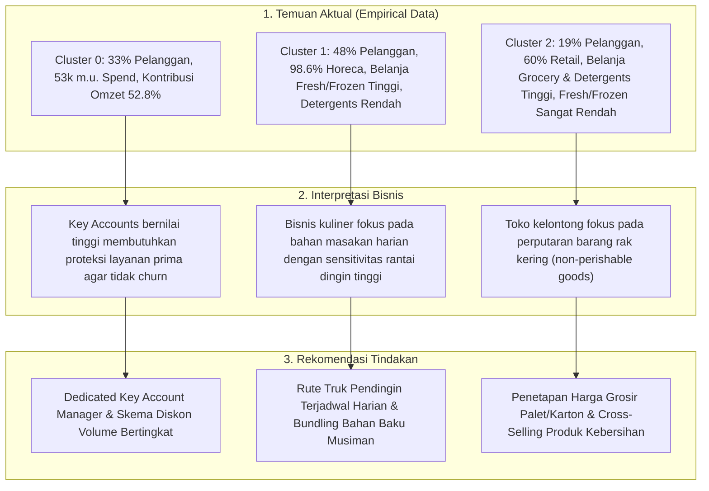

### 1. Strategi untuk Cluster 0: Broad-Category High Spenders (Key Accounts)
- **Temuan Aktual:** 145 pelanggan ini menghasilkan 7,72 juta m.u. atau 52,84% dari total perputaran omzet distributor. Rata-rata pengeluaran totalnya (53.273,41 m.u.) adalah 2,5 kali lipat rata-rata Cluster 1.
- **Interpretasi Bisnis:** Klien-klien ini merupakan fondasi profitabilitas distributor. Kehilangan 2 atau 3 akun dari segmen ini akan memberikan pukulan material terhadap arus kas distributor (*high client concentration risk*).
- **Rekomendasi Tindakan:**
  1. *Dedicated Account Representative:* Tunjuk manajer akun khusus untuk melayani pemesanan, negosiasi kontrak, dan penanganan komplain prioritas.
  2. *Tiered Volume Rebates:* Terapkan insentif potongan harga tahunan bersyarat jika pelanggan mempertahankan atau menaikkan volume belanjanya di atas ambang kuota tertentu.
  3. *Unified Multi-Temperature Delivery:* Karena mereka membeli produk kering dan dingin dalam volume masif, sediakan armada truk kompartemen ganda (*multi-temp fleet*) agar seluruh pesanan dapat dikirimkan dalam satu jadwal tanpa pembagian vendor.

### 2. Strategi untuk Cluster 1: Fresh & Frozen / Horeca Focused
- **Temuan Aktual:** Mencakup 212 pelanggan yang hampir homogen berasal dari saluran Horeca (98,58%). Rata-rata pengeluaran untuk `Fresh` (11.992,59 m.u.) dan `Frozen` (3.277,84 m.u.) sangat tinggi, sementara `Detergents_Paper` hanya 425,91 m.u.
- **Interpretasi Bisnis:** Hotel, kafe, dan restoran memprioritaskan kesegaran bahan makanan dapur yang harus diolah setiap hari. Mereka enggan membeli produk pembersih dari distributor bahan pangan, kemungkinan karena telah memiliki pemasok kimia sanitasi khusus industri atau keterbatasan ruang simpan.
- **Rekomendasi Tindakan:**
  1. *Scheduled Cold-Chain Routine:* Jadwalkan pengiriman bahan segar di pagi hari sebelum jam operasional dapur restoran dimulai (pukul 06.00 - 09.00) dengan jaminan kontrol suhu rantai dingin.
  2. *Seasonal Menu Ingredient Bundling:* Tawarkan paket bahan makanan tematik musiman (misal: paket *seafood* beku + sayuran segar musiman) untuk menyederhanakan proses pemesanan juru masak (*chef*).
  3. *Food-Grade Sanitizer Introduction:* Hindari mempromosikan deterjen umum; tawarkan produk sanitasi khusus industri pangan (*food-grade kitchen sanitizer*) dalam kemasan kecil yang relevan dengan regulasi kebersihan dapur.

### 3. Strategi untuk Cluster 2: Grocery & Detergents / Retail Specialists
- **Temuan Aktual:** 83 pelanggan dengan belanja tinggi pada `Grocery` (rata-rata 12.397,28 m.u.) dan `Detergents_Paper` (rata-rata 5.446,23 m.u.), namun sangat minim pada `Fresh` (rata-rata 2.966,93 m.u.) dan `Frozen` (rata-rata 608,28 m.u.).
- **Interpretasi Bisnis:** Toko kelontong dan peritel mandiri berfokus pada produk dengan masa simpan panjang (*shelf-stable goods*) yang tidak memerlukan investasi lemari pendingin berbiaya listrik tinggi.
- **Rekomendasi Tindakan:**
  1. *Pallet-Tier Wholesale Pricing:* Terapkan struktur harga berbasis karton dan palet bertingkat untuk beras, minyak, tepung, dan deterjen rumah tangga guna mendorong pembelian volume penuh.
  2. *Cross-Category Co-Promotions:* Manfaatkan korelasi kuat antara `Grocery` dan `Detergents_Paper` ($r = 0,92$) dengan merancang program promosi silang (misal: diskon pembelian kertas tisu/sabun cuci setiap pemesanan sembako dalam kuantitas tertentu).
  3. *Flexible Working Capital Terms:* Peritel sering kali sensitif terhadap perputaran kas modal kerja. Berikan opsi pembayaran tempo (TOP 14 atau 30 hari) bagi toko ritel yang memiliki rekam jejak pembayaran lancar.

---

## Interactive Streamlit Application

Sebagai bagian dari implementasi analitis, dibangun aplikasi dasbor interaktif berbasis web menggunakan **Streamlit** (`app.py`). Aplikasi ini memungkinkan manajemen distributor dan tim *sales* untuk memfilter, mengeksplorasi, dan memproyeksikan data pelanggan secara dinamis.

### Panduan Menjalankan Aplikasi
Aplikasi dapat dijalankan secara lokal dengan langkah berikut:
```bash
# Pastikan dependensi telah terpasang
pip install -r requirements.txt

# Jalankan dashboard Streamlit
python -m streamlit run app.py
```
Aplikasi akan secara otomatis aktif dan dapat diakses melalui browser pada `http://localhost:8501`.

### Fitur Utama Dashboard
- **Filter Multidimensi:** Filter berdasarkan klaster segmen belanja, saluran pelanggan (`Horeca` vs `Retail`), dan wilayah (`Lisbon`, `Oporto`, `Other Region`).
- **Interactive KPI Cards:** Menampilkan jumlah pelanggan terpilih, total pengeluaran (m.u.), rata-rata pengeluaran per pelanggan, dan saluran dominan.
- **Proyeksi PCA 2D Interaktif:** Menampilkan posisi sebaran pelanggan dalam ruang komponen utama dengan penanda visual bagi titik data yang sedang difilter.
- **Grafik Komparasi Belanja (Mean vs Median):** Menampilkan perbandingan belanja nominal pada keenam kategori barang secara instan.
- **Customer Data Explorer:** Tabel data pelanggan interaktif yang dilengkapi fitur pengurutan dan pencarian.

### Verifikasi Tangkapan Layar (Full Page Screenshot)
Tangkapan layar halaman penuh (*full-page screenshot*) telah diambil menggunakan otomasi Chrome DevTools Protocol (CDP) untuk memastikan seluruh elemen visual, kontrol, dan tabel terdokumentasi tanpa pemotongan *viewport*:

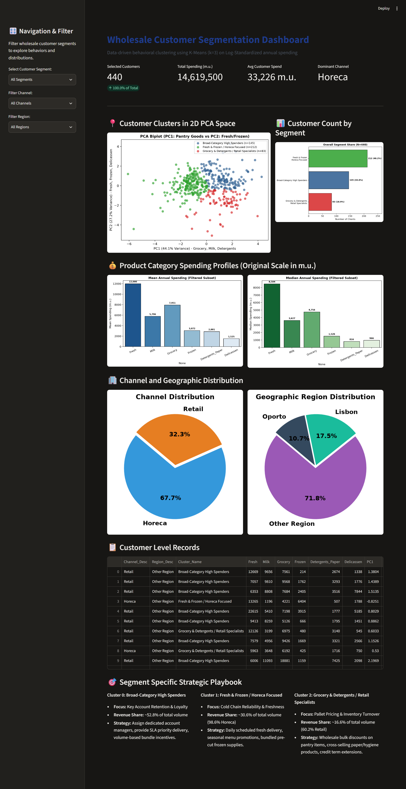

---

## Limitations

Dalam menerapkan hasil segmentasi ini pada keputusan operasional riil, distributor harus memperhatikan sejumlah batasan teknis dan kontekstual:

1. **Ketiadaan Dimensi Waktu (*No Temporal Dimension*):** Dataset hanya menyajikan total pengeluaran tahunan agregat tanpa rincian tanggal transaksi. Akibatnya, analisis ini tidak dapat mengidentifikasi pola musiman (*seasonality*), tren peningkatan/penurunan belanja (*recency*), maupun frekuensi kunjungan (*RFM metrics*).
2. **Ketiadaan Data Profitabilitas & Marjin Biaya:** Angka pengeluaran dinyatakan dalam omzet penjualan (*revenue/spending in m.u.*), bukan laba bersih (*net margin*). Cluster 0 menyumbang omzet terbesar, namun jika produk yang dibeli memiliki marjin tipis dan menuntut diskon tinggi, profitabilitas riilnya mungkin berbeda dari estimasi volume.
3. **Ukuran dan Usia Dataset:** Data terdiri dari 440 observasi yang dikumpulkan pada tahun 2013 di Portugal. Struktur pasar grosir, adopsi *e-commerce*, dan tingkat inflasi telah banyak berubah, sehingga parameter model perlu dikalibrasi ulang (*retrained*) apabila diterapkan pada data operasional terkini.
4. **Sifat Metrik Klasterisasi Internal:** Skor evaluasi internal seperti Silhouette Score ($0,2583$) mengukur derajat keterpisahan matematis dalam ruang metrik, bukan jaminan kesuksesan strategi pemasaran. Nilai silhouette yang berada di kisaran 0,25-0,30 mengindikasikan adanya tumpang tindih (*overlap*) antar perbatasan klaster, yang wajar terjadi pada data perilaku belanja dunia nyata.
5. **Ketiadaan Klaim Kausalitas:** Hubungan antara klaster pengeluaran dengan variabel `Channel` atau `Region` bersifat asosiatif deskriptif, bukan kausal. Keanggotaan sebuah restoran pada saluran Horeca tidak serta merta menyebabkan restoran tersebut masuk ke Cluster 1 jika kapasitas belanjanya berskala mega seperti Cluster 0.

---

## Conclusion

Proyek segmentasi pelanggan *Wholesale Customers* telah diselesaikan secara menyeluruh (*end-to-end*). Melalui kombinasi audit data yang teliti, normalisasi transformasi `log1p` yang menghilangkan bias *outlier*, serta evaluasi algoritma pembanding, ditetapkan **K-Means dengan $k = 3$** sebagai arsitektur segmentasi final.

Ketiga segmen yang terbentuk mencerminkan struktur alami yang sangat kuat dan intuitif secara bisnis:
1. **Cluster 0 (Broad-Category High Spenders):** 145 pelanggan *Key Accounts* dengan belanja tinggi di seluruh kategori, menyumbang 52,8% omzet distributor.
2. **Cluster 1 (Fresh & Frozen / Horeca Focused):** 212 pelanggan sektor perhotelan/kuliner (98,6% Horeca) yang mengutamakan bahan segar dan beku untuk kebutuhan dapur harian.
3. **Cluster 2 (Grocery & Detergents / Retail Specialists):** 83 pelanggan toko ritel/sembako yang berfokus pada bahan kering kemasan dan perlengkapan pembersih rumah tangga.

Diferensiasi ini memberikan fondasi analitis yang konkret bagi distributor grosir untuk mengoptimalkan alokasi tenaga penjual, merancang rute logistik rantai dingin secara efisien, serta memberikan insentif harga yang relevan dengan kebutuhan riil masing-masing kelompok pelanggan.

---

## Reproducibility

Seluruh kode, script, dan notebook dalam proyek ini dirancang agar dapat direproduksi sepenuhnya (*100% reproducible*).

### Struktur Berkas Repositori
```text
Wholesale Customer Segmentation Using K-Means/
├── Wholesale_Customers.csv         # Salinan dataset utama di root
├── metadata.json                   # Metadata resmi dataset
├── TASK.md                         # Lembar instruksi dan kriteria pengerjaan
├── final_report.md                 # Dokumen laporan akhir komprehensif ini
├── requirements.txt                # Daftar dependensi Python
├── app.py                          # Kode sumber dasbor interaktif Streamlit
├── src/
│   └── clustering.py               # Pipeline pemodelan dan pembuatan visualisasi
├── notebooks/
│   └── customer_segmentation.ipynb # Notebook eksekusi dan analisis interaktif
└── outputs/
    ├── clustered_customers.csv     # Data 440 pelanggan dengan label klaster & koordinat PCA
    ├── cluster_profiles.csv        # Tabel ringkasan statistik belanja & proporsi segmen
    ├── model_comparison.csv       # Tabel perbandingan metrik evaluasi model k=2..10
    ├── figures/                    # 11 berkas visualisasi format PNG (150 DPI)
    │   ├── spending_distributions.png
    │   ├── spending_boxplots.png
    │   ├── correlation_heatmap.png
    │   ├── elbow_plot.png
    │   ├── silhouette_scores.png
    │   ├── model_comparison.png
    │   ├── pca_clusters.png
    │   ├── cluster_profile_heatmap.png
    │   ├── cluster_sizes.png
    │   ├── spending_profiles_raw.png
    │   └── channel_region_profiles.png
    └── screenshots/
        └── streamlit_full_page.png # Bukti tangkapan layar penuh dasbor Streamlit
```

### Langkah Menjalankan Ulang (*How to Reproduce*)
1. Pasang seluruh dependensi yang tertera pada `requirements.txt`:
   ```bash
   pip install -r requirements.txt
   ```
2. Jalankan pipeline analisis dan pemodelan:
   ```bash
   python src/clustering.py
   ```
   *Script ini akan memuat data, mengevaluasi model k=2..10, menghasilkan model final, menyimpan tabel CSV hasil ke `outputs/`, dan merender seluruh grafik ke `figures/`.*
3. Buka dan jalankan Jupyter Notebook jika ingin mengeksplorasi langkah per langkah secara visual:
   ```bash
   jupyter notebook notebooks/customer_segmentation.ipynb
   ```
4. Jalankan dasbor interaktif:
   ```bash
   python -m streamlit run app.py
   ```
